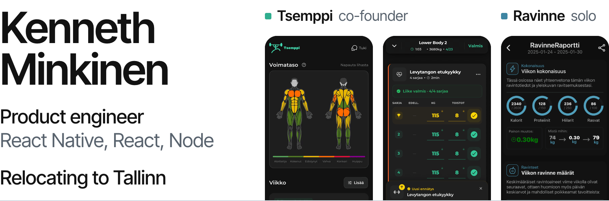

<picture>
  <source media="(prefers-color-scheme: dark)" srcset="assets/header-dark.png">
  
</picture>

I build mobile apps and the servers behind them. Two are live on the App Store and Google Play: [Tsemppi](https://apps.apple.com/fi/app/id6757228735?l=en), a workout app I co-founded and lead development on, and [Ravinne](https://apps.apple.com/fi/app/id6744070817?l=en), a nutrition tracker I built alone. Most days that means React Native with Expo on the phone and Node with Express and MongoDB on the server. When a widget or a watch app needs it, I write the Swift and Kotlin too.

I'm an EU citizen (half-Estonian, half-Finnish) relocating to Tallinn, so there is no visa or sponsorship to sort out. I'm looking for a full-stack or product engineering role there. The quickest way to reach me is [LinkedIn](https://www.linkedin.com/in/kenneth-minkinen-118643281/).

## Tsemppi

A strength training app for iPhone, Android, Apple Watch and Wear OS. **3,756 people have signed up since it launched in February 2026.** In the 30 days to 26 September, 1,319 people used the app and logged 32,298 sets. It has 1K+ downloads on Google Play, and the latest of its 11 App Store releases went out on 22 September 2026.

We are three founders and I lead development. In the app repo, 418 of the 421 commits on main are mine: the React Native app, the Express API, and the native widgets and watch apps. I also built the admin dashboard in our Next.js website, where we answer support chats in real time.

- About 250 API endpoints and 25 MongoDB models. The 25 scheduled jobs run in their own worker process under PM2, apart from the API.
- Native code: 17k lines of Swift for the iOS widgets, Live Activities, notification extension and watchOS app, and 15k lines of Kotlin, mostly the Wear OS app.
- The interface ships in Finnish, English, Swedish, Danish and Norwegian, 8,302 strings each.
- 749 test files with about 11,800 cases. The full suite runs before every commit and again in CI.

[App Store](https://apps.apple.com/fi/app/id6757228735?l=en) | [Google Play](https://play.google.com/store/apps/details?id=com.tsemppi.app) | [tsemppiapp.fi](https://tsemppiapp.fi) | [Case study](https://github.com/KennethMin/tsemppi-case-study)

## Ravinne

A calorie and nutrition tracker for iPhone and Android. I built all of it alone, from the app and the Node API to the admin dashboard and the website: every one of the 284 commits in the app repo and the 39 in the website repo is mine. **It has been on the App Store since November 2025**, with 500+ downloads on Google Play.

You can log a meal by scanning a barcode, taking a photo or saying it out loud. The weekly calorie target comes from a deterministic algorithm that never moves it by more than 200 kcal in a week. The website, [ravinne.fi](https://ravinne.fi), is Next.js 16 and TypeScript, with 17 calculators and 67 sourced articles across 97 URLs.

[App Store](https://apps.apple.com/fi/app/id6744070817?l=en) | [Google Play](https://play.google.com/store/apps/details?id=com.kende6644.StickerSmash) | [ravinne.fi](https://ravinne.fi) | [Case study](https://github.com/KennethMin/ravinne-case-study)

## Engineering notes

- Tsemppi used to score workout routines with an LLM, from 1 to 10, and asking twice could give the same routine two different scores. I replaced it with a pure function, shared by the app and the server, that counts effective weekly sets per muscle. The model now only writes a note, and the server drops the note if it quotes a number the function didn't compute.
- Raw phone GPS overstates run distance by 5-15%. The run recorder only counts a new point once it is more than twice its reported accuracy away from the last one, because two readings taken while you wait at a crossing can differ by that much. The filter is tested against synthetic traces, so no device is needed.
- A training plan can be edited with one sentence. The model sees rows only as refs (r1 to rN) and returns up to 8 intents, checked against a strict JSON schema. The app applies them through the plan screen's own edit operations, with undo, so the model never writes a row.
- The progression engine writes the next session and never moves a weight by more than one equipment increment at a time. It logs what it prescribed next to what was lifted. Before a lift it commits to a prediction. It reports hits out of predictions judged, and stays quiet until 5 have been judged.
- Quiet hours hold a deferrable push until the window ends and drop the time-bound ones. After a cron job once sent a push to the whole user base, I added a daily cap on distinct recipients.
- Exercise search folded accents with Unicode decomposition, which has none for ø and æ, so it deleted them. Mapping them by hand took the Danish query "loft" (for "løft") from 0 to 43 results.
- In Ravinne's rebuild, which is on main but not in the stores yet, barcode lookups check a 38,796-food SQLite database bundled with the app before calling the API. Photo and voice results are matched against the same database: a good match replaces the model's recalled nutrition with the database row and a household portion, and a weak one is only offered as an alternative.

## Other work

- [maxehitus.ee](https://maxehitus.ee) is the Estonian-language site of a construction company in Rakvere: 44 pages in Next.js 16 and TypeScript, with a price calculator. Three redirects once turned out to 404 in production, so I added a post-deploy script that checks every route and redirect against the live site.
- kapahoid.ee is the site of a family-run dog hotel in Rakvere, also in Estonian. Its booking calculator handles weekend and holiday surcharges and a weekly discount, which is why 7 nights can cost less than 6.
- Reseptikirja is a Finnish recipe and meal-planning web app I'm still building. It is Next.js 16 and TypeScript in a Turborepo on Postgres, with Finnish full-text search, and CI fails the build when a route's JavaScript goes over its budget.

The two client sites run on a Hetzner server I manage, behind nginx with PM2. The source for all of this is private. The case studies explain how the two apps work, and I'm glad to walk through the code in an interview.

Tools I use most: React Native with Expo, Next.js, Node with Express, MongoDB, Postgres, Jest, Sentry, PostHog and RevenueCat. The two apps are JavaScript, while ravinne.fi and everything under Other work are TypeScript.
